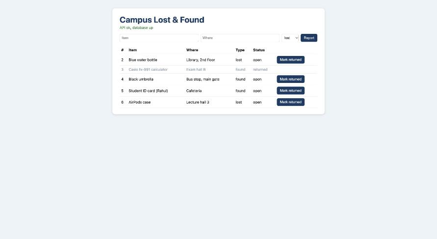
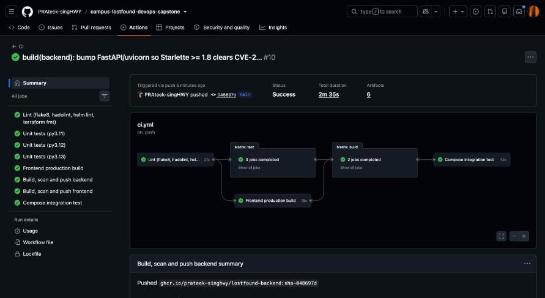
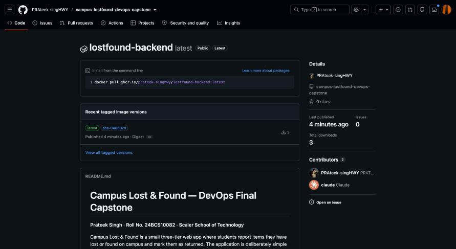
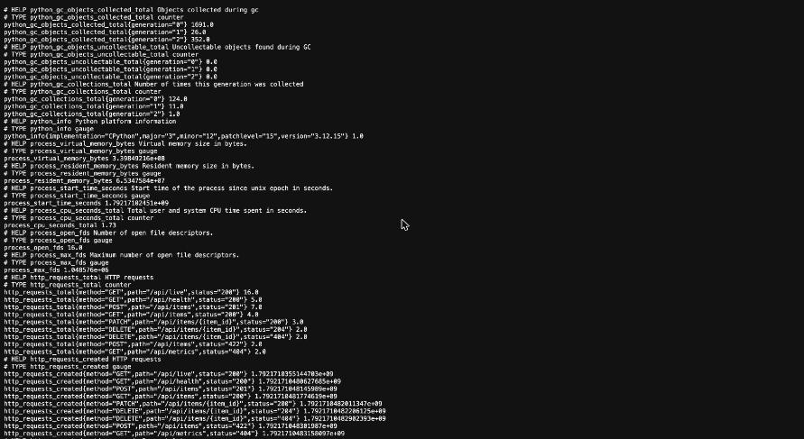
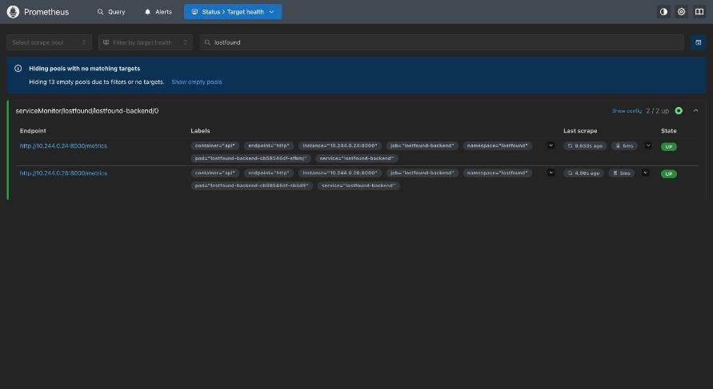
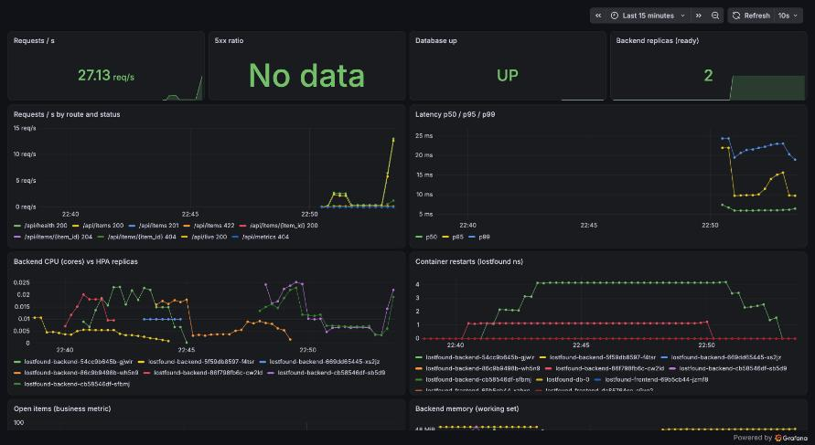

# Campus Lost & Found — DevOps Final Capstone

**Prateek Singh · Roll No. 24BCS10082 · Scaler School of Technology**

Campus Lost & Found is a small three-tier web app where students report items they have lost or
found on campus and mark them as returned. The application is deliberately simple so that every
DevOps layer around it can be demonstrated end to end and reproduced from this repository:

**React/nginx · FastAPI · PostgreSQL (Alembic) · pytest · Docker · docker compose · GitHub Actions
· Trivy · GHCR · Terraform (AWS VPC + EKS) · Kubernetes · Helm · Ingress · HPA · Prometheus · Grafana**

```text
 git push ──► GitHub Actions ─┬─ flake8 · hadolint · helm lint · terraform validate
                              ├─ pytest (3.11/3.12/3.13, 80 % coverage gate) · frontend build
                              ├─ docker build ─► Trivy (fail on HIGH/CRITICAL) ─► push ghcr.io  tag = sha-<commit>
                              ├─ docker compose integration test from the pushed images
                              └─ CD: helm upgrade --install on a kind cluster ─► smoke test
                                                                                        │
   Ingress (nginx)  ─── /     ──► Service frontend ──► Deployment nginx+React (x2, non-root)      │
      lostfound.local   /api  ──► Service backend  ──► Deployment FastAPI (x2..5, HPA) ──► StatefulSet PostgreSQL (PVC)
                                                              │ /metrics
                                               ServiceMonitor ─► Prometheus ─► Alertmanager · Grafana dashboard
```

Full design notes: [`docs/architecture.md`](docs/architecture.md). Debugging runbook with real
incidents from this cluster: [`docs/troubleshooting.md`](docs/troubleshooting.md). Captured output
from every run referenced below: [`docs/evidence/`](docs/evidence) and [`docs/screenshots/`](docs/screenshots).

---

## Repository layout

```text
backend/            FastAPI app (app/main.py), Alembic migrations, pytest suite, Dockerfile, entrypoint.sh
frontend/           React (Vite) app, nginx template, multi-stage Dockerfile (nginx-unprivileged)
docker-compose.yml  Local three-tier stack on http://localhost:3000 (+ optional prometheus/grafana profile)
k8s/                Namespace bootstrap and gp3 StorageClass for EKS
helm/lostfound/     Helm chart: Postgres StatefulSet, backend/frontend Deployments, Services, Ingress, HPA, ServiceMonitor, PrometheusRule
terraform/          AWS: VPC with two public subnets, EKS cluster + managed node group, IAM, encrypted S3 backups bucket
monitoring/         kube-prometheus-stack values, Alertmanager routing, Grafana dashboard JSON
.github/workflows/  ci.yml (lint → test → build/scan/push → integration), cd.yml (Helm to kind), terraform.yml
scripts/            cluster-up.sh, deploy.sh, smoke-test.sh, monitoring-up.sh, load.sh
docs/               architecture, troubleshooting runbook, evidence and screenshots
```

---

## M1 · Application

| Tier | Tech | Notes |
|---|---|---|
| Frontend | React 18 + Vite, served by **nginx-unprivileged** | nginx also reverse-proxies `/api` to `${BACKEND_HOST}:${BACKEND_PORT}` (env-substituted at start) |
| Backend | Python 3.12, **FastAPI**, psycopg 3, prometheus-client, **Alembic** | `entrypoint.sh` waits for Postgres, runs `alembic upgrade head`, starts uvicorn |
| Database | **PostgreSQL 16** | `items` table created by migration `0001`, check constraints by `0002` |

### REST API

| Method | Path | Purpose | Status |
|---|---|---|---|
| GET | `/health`, `/api/live` | Liveness: process is up (never touches the DB) | 200 |
| GET | `/api/health` | Readiness: `SELECT 1` against Postgres; **503** if unreachable | 200 / 503 |
| GET | `/metrics` | Prometheus exposition format | 200 |
| GET | `/api/items` | List items | 200 |
| GET | `/api/items/{id}` | One item | 200 / 404 |
| POST | `/api/items` | Report an item `{title, location, kind: lost\|found}` | 201 / 422 |
| PUT | `/api/items/{id}` | Replace title/location/kind | 200 / 404 / 422 |
| PATCH | `/api/items/{id}` | Change status `{status: open\|returned}` | 200 / 404 / 422 |
| DELETE | `/api/items/{id}` | Delete | 204 / 404 |

Interactive docs: `http://localhost:8000/docs`.



---

## M2 · Testing

```bash
cd backend && pip install -r requirements-dev.txt && flake8 app tests alembic && pytest -v
```

Nine tests cover six endpoints (`/health`, `/api/live`, `/api/health`, `/api/items`, `/api/items/{id}`
with GET/PUT/PATCH/DELETE, `/metrics`). They run against an **in-memory fake of the psycopg
connection** defined in `backend/tests/conftest.py`, so no database is needed and the production
database is never touched. `pytest.ini` enforces an **80 % coverage gate** (currently 87 %).
Output: [`docs/evidence/02-unit-tests.txt`](docs/evidence/02-unit-tests.txt).

---

## M3 · Git and GitHub

Public repository, conventional commit messages (`feat(backend): …`, `ci: …`, `docs: …`), and a
`.gitignore` that excludes `.env`, `__pycache__`, `node_modules`, `.venv`, Terraform state and
`*.pem`. No credentials are committed; AWS access goes through a named CLI profile and
`TF_VAR_*` environment variables.

---

## M4 · Docker

```bash
docker compose up --build          # http://localhost:3000  (API on :8000)
docker compose down -v             # stop and delete the database volume
```

- **`backend/Dockerfile`**: `python:3.12-slim`, dependencies layered before code, runs as
  `uid 10001 (api)`, `HEALTHCHECK` on `/api/live`.
- **`frontend/Dockerfile`**: **multi-stage** — `node:20-alpine` builds the bundle, only `dist/`
  is copied into `nginxinc/nginx-unprivileged:1.27-alpine` (runs as `nginx`, listens on 8080).
- **Compose**: `db` has a `pg_isready` healthcheck, `backend` waits for `service_healthy`,
  `frontend` waits for the backend's healthcheck; two networks so the frontend cannot reach the
  database directly; `pgdata` named volume for persistence.

Evidence (ps, non-root `id`, Alembic log, smoke test):
[`docs/evidence/01-compose-up-and-smoke.txt`](docs/evidence/01-compose-up-and-smoke.txt).

---

## M5 · CI/CD (GitHub Actions)

`.github/workflows/ci.yml` runs on every push and pull request to `main`:

| Job | What it does | Fails the build when |
|---|---|---|
| **lint** | flake8, hadolint on both Dockerfiles, `helm lint` (dev + prod values), `terraform fmt/validate` | any linter fails |
| **test** | `pytest` on Python 3.11 / 3.12 / 3.13, JUnit + coverage artifacts | a test fails or coverage < 80 % |
| **frontend-build** | `npm run build`, uploads `dist/` | the React build breaks |
| **build** (matrix: backend, frontend) | `docker buildx` with GHA cache → **Trivy** → push to **GHCR** as `ghcr.io/prateek-singhwy/lostfound-<component>:sha-<7 chars>` (plus `latest`) | HIGH/CRITICAL CVE, or push fails |
| **integration** | `docker compose up` from the images just pushed, then `scripts/smoke-test.sh` | any API check fails |

| | |
|---|---|
|  |  |

`.github/workflows/cd.yml` runs when CI is green on `main`: creates a kind cluster, installs the
Prometheus Operator CRDs, `helm upgrade --install` with `image.tag=sha-<commit>`, smoke-tests through
the frontend Service and prints `helm history`. Image tags are the **commit SHA**, so every
deployment is traceable and `helm rollback` returns to a known image.

`.github/workflows/terraform.yml` runs `fmt`, `validate`, `tflint`, and a plan/apply/destroy of
the network + S3 subset against **LocalStack** so the IaC is exercised on every change without
cloud credentials.

---

## M6 · DevSecOps (Trivy)

Both images are scanned in the `build` job with `aquasecurity/trivy-action`, `severity: HIGH,CRITICAL`,
`exit-code: 1`, `ignore-unfixed: true`. Trivy inspects the OS packages of the base image
(Debian for the backend, Alpine for the frontend) and the language dependencies (`pip` packages,
`npm` packages that survive into `dist/`). The gate fired for real on the first full run
([`docs/evidence/12-trivy-findings.txt`](docs/evidence/12-trivy-findings.txt)): the
`nginx-unprivileged:1.27-alpine` base image carried **CVE-2026-31789** (CRITICAL, OpenSSL heap
buffer overflow in `libcrypto3`/`libssl3` 3.3.3) and **CVE-2026-33630** (HIGH, use-after-free in
`c-ares`), both with fixed Alpine packages available, so the build was blocked and no image was
pushed. The fix was to move to the current `1.29-alpine` tag and run `apk upgrade` in the
Dockerfile; the backend image got the equivalent `apt-get upgrade`. Unfixed CVEs are reported but
do not block (`ignore-unfixed`), because no upstream patch exists yet.

---

## M7 · Terraform (AWS)

```bash
cd terraform
cp terraform.tfvars.example terraform.tfvars      # set aws_profile, region, sizes
terraform init
terraform plan
terraform apply                                   # VPC, 2 public subnets, IGW, SG, EKS 1.31 + 2× t3.medium, EBS CSI + metrics-server add-ons, S3 backups bucket
$(terraform output -raw configure_kubectl)        # aws eks update-kubeconfig …
kubectl apply -f k8s/namespace.yaml -f k8s/storageclass-gp3.yaml
helm upgrade --install lostfound helm/lostfound -n lostfound -f helm/lostfound/values-prod.yaml
terraform destroy                                 # tear everything down after the evaluation
```

| File | Resources |
|---|---|
| `network.tf` | VPC `10.50.0.0/16`, two public subnets across AZs (tagged `kubernetes.io/role/elb`), IGW, route table |
| `eks.tf` | IAM roles, EKS control plane, managed node group (1–3 nodes), `aws-ebs-csi-driver` and `metrics-server` add-ons |
| `security.tf`, `iam.tf`, `compute.tf` | Optional EC2 host (`enable_app_host=true`) that runs the stack with docker compose from GHCR images |
| `storage.tf` | Versioned, encrypted, private S3 bucket for nightly `pg_dump` backups with 30-day expiry |
| `provider.tf` | `use_localstack=true` redirects every API call to LocalStack (used by CI) |

`terraform.tfvars.example` is committed; `terraform.tfvars`, state files and `.terraform/` are
ignored. Validation output: [`docs/evidence/04-terraform-validate.txt`](docs/evidence/04-terraform-validate.txt).
Plan/apply/destroy output against the real account is in `docs/evidence/08-terraform-*.txt` when present.

---

## M8 · Kubernetes + Helm

```bash
./scripts/cluster-up.sh                  # minikube + ingress + metrics-server
./scripts/deploy.sh v1                   # build images, load into minikube, helm upgrade --install
kubectl get pods,svc,ingress,hpa -n lostfound
helm list -n lostfound
```

The chart (`helm/lostfound`) creates: Namespace-scoped **Secret** for DB credentials (or
`existingSecret`), **ConfigMap**, **StatefulSet** + headless Service for PostgreSQL with a PVC,
**Deployments** for backend and frontend (2 replicas each, rolling update with `maxUnavailable: 0`,
startup/readiness/liveness probes, non-root security context), **ClusterIP Services**, an
**Ingress** routing `/api` → backend and `/` → frontend, a **HorizontalPodAutoscaler** (CPU 60 %),
and, when the Prometheus Operator is present, a **ServiceMonitor** and **PrometheusRule**.
`values-dev.yaml` and `values-prod.yaml` show the same chart targeting minikube and EKS (gp3,
TLS via cert-manager, PodDisruptionBudget).

Evidence: pods Running, Services, Ingress, `helm list`, smoke test through the Service, and a
`200 OK` through the Ingress controller —
[`docs/evidence/05-k8s-deploy-and-smoke.txt`](docs/evidence/05-k8s-deploy-and-smoke.txt).

---

## M9 · Observability

```bash
./scripts/monitoring-up.sh      # kube-prometheus-stack + dashboard ConfigMap + enable ServiceMonitor
kubectl -n monitoring port-forward svc/kps-prometheus 9090:9090    # http://localhost:9090/targets
kubectl -n monitoring port-forward svc/kps-grafana 3001:80         # http://localhost:3001  admin / lostfound-grafana
```

- The backend exposes `http_requests_total{method,path,status}`, `http_request_duration_seconds`
  (histogram), `lostfound_db_up` and `lostfound_items_open` on `/metrics`.
- Prometheus discovers both backend pods through the chart's ServiceMonitor (15 s interval).
- Five alerts ship with the chart: high 5xx ratio, p95 latency > 500 ms, database down, pod
  restarting, pod not ready; Alertmanager routes `app=lostfound` to its own receiver.
- Grafana loads **Campus Lost & Found** from `monitoring/grafana/lostfound-dashboard.json`:
  request rate by route/status, latency p50/p95/p99, 5xx ratio, DB up, CPU vs HPA replicas,
  restarts, memory and open items.

| | |
|---|---|
|  |  |
|  | |

---

## M10 · Demo flow

1. Edit something visible (for example the page title in `frontend/src/main.jsx`), commit, push.
2. Watch **Actions → CI**: lint → tests → frontend build → image build + Trivy → GHCR push with
   `sha-<commit>` → compose integration test.
3. **CD** deploys that exact tag with Helm and prints `helm history`.
4. Locally: `./scripts/deploy.sh $(git rev-parse --short=7 HEAD)` rolls the same commit onto
   minikube; `helm rollback lostfound <rev>` goes back.

---

## Pipeline runs and cloud evidence

| What | Where |
|---|---|
| CI run (lint → tests → frontend build → Trivy → GHCR push → compose integration) | https://github.com/PRAteek-singHWY/campus-lostfound-devops-capstone/actions/workflows/ci.yml |
| CD run (Helm deploy to kind + smoke test) | https://github.com/PRAteek-singHWY/campus-lostfound-devops-capstone/actions/workflows/cd.yml |
| Terraform workflow (fmt, validate, tflint, LocalStack apply/destroy) | https://github.com/PRAteek-singHWY/campus-lostfound-devops-capstone/actions/workflows/terraform.yml |
| Published images | https://github.com/PRAteek-singHWY?tab=packages |
| `terraform plan` against the real account (26 resources) | [`docs/evidence/08-terraform-plan.txt`](docs/evidence/08-terraform-plan.txt) |
| `terraform apply` / `destroy` output | `docs/evidence/09-terraform-apply.txt`, `docs/evidence/11-terraform-destroy.txt` |

The capstone AWS account sits under an AWS Organization whose service control policy only allows
**ap-southeast-2** and denies S3, so `terraform.tfvars` targets Sydney with
`enable_backups_bucket = false`. The same code runs unchanged in an unrestricted account with the
defaults in `terraform.tfvars.example`.

## Troubleshooting

Real incidents from building this project, with the diagnosis commands and fixes, are in
[`docs/troubleshooting.md`](docs/troubleshooting.md) and the raw output in
[`docs/evidence/06-troubleshooting-drills.txt`](docs/evidence/06-troubleshooting-drills.txt):
backend restarting on first boot (DB retry budget), wrong `DB_HOST`, Helm server-side-apply
conflict after a `kubectl patch`, ServiceMonitor selecting nothing because of a missing label,
and `minikube docker-env` failing on containerd.

## Cleanup

```bash
docker compose down -v
helm uninstall lostfound -n lostfound && helm uninstall kps -n monitoring
minikube delete
cd terraform && terraform destroy
```
